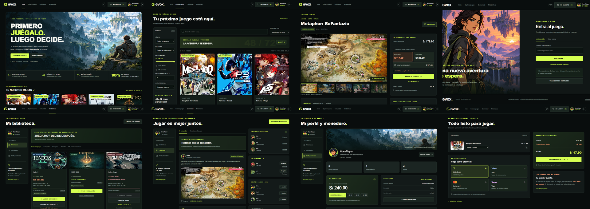

# GVOX · Entrega final

29 de octubre de 2026. Integración sobre la aplicación existente, conservando HTML, CSS, JavaScript modular, las ocho pantallas y los veinte videojuegos. Sin migración de arquitectura ni nuevas dependencias para ejecutar Gvox.

## Pantallas modificadas

| Pantalla | Resultado |
|---|---|
| Inicio | Ilustración horizontal independiente de aventura, lema original, dos acciones principales, franja de alquiler más limpia, portadas reales y separación entre secciones. |
| Catálogo | Búsqueda y orden más legibles, tres columnas a 1440 y cuatro a 1920, tarjetas con más espacio, títulos completos, descuentos y favoritos conservados. |
| Acceso | Aventurera cartoon independiente, formulario separado, correo y código numérico, registro y recuperación locales. Corregido el acceso que podía sobrescribir el nombre personalizado de otra cuenta. |
| Ficha | Jerarquía y legibilidad compartidas; galería, requisitos, modalidades, favoritos y reseñas conservados. |
| Carrito | Saldo Gvox, Visa, Mastercard y Yape; identificación del método en el recibo, totales en soles, sin pedir datos bancarios. |
| Biblioteca | Compra, alquiler y vencimiento diferenciados con texto y colores. Botón vencido neutro, barra vencida rojiza y temporizador conservado. |
| Comunidad | Avatares cartoon, opiniones y publicaciones variadas, estados en línea/ausente/desconectado. Corregido el contador que incluía ausentes entre los conectados. Aviso general de simulación conservado. |
| Perfil y monedero | Diez avatares seleccionables sin nombres visibles; selección actual identificada, incluido Goku sin etiqueta especial. Paisaje de aventura en el encabezado e historial compacto, sin un panel vacío de gran altura. Perfil, privacidad, saldo e historial conectados. |

El mismo logotipo vectorial de GVOX aparece en el encabezado y pie de las ocho pantallas. La G tiene geometría angular propia y mantiene el verde lima y el nombre blanco.

## Recursos y documentos

- Dos ilustraciones nuevas optimizadas en `assets/img/ilustraciones/`: inicio de **1672 × 941 px** y acceso de **1086 × 1448 px**. Son escenas independientes; ningún wireframe se usa como fondo.
- Diez avatares WebP individuales de **224 × 224 px**, extraídos del interior de la lámina sin textos, marcos ni imágenes vecinas. Se revisaron como archivos y en el selector del navegador.
- Tres SVG activos ajustados: logotipo horizontal, símbolo y favicon, con la misma geometría.
- ZIP y referencias conservados fuera del código publicado en la carpeta superior `referencias/`. Allí se conservan también los PNG generados y los [prompts de las ilustraciones](../../referencias/PROMPTS_ILUSTRACIONES.md).
- PDF completo de 52 páginas copiado a `00_MATERIAL_ORIGINAL/GVOX_REQUISITOS_ORIGINALES.pdf`, idéntico al original por SHA-256. Se contrastaron las HU01–HU25 de las páginas 36–51. La [matriz de cobertura](COBERTURA_REQUISITOS.md) enlaza ahora esa copia y mantiene las limitaciones por criterio.

## Revisión práctica de usabilidad

| Heurística de Nielsen | Aplicación comprobada |
|---|---|
| Estado visible | Confirmaciones de favoritos, perfil, saldo y comunidad; recibo de pago; temporizadores y bloqueo de licencias vencidas. |
| Lenguaje del usuario | Navegación en español, soles y modalidades de 48/72 horas; métodos reconocibles. |
| Control y libertad | Cerrar diálogos, usar otro correo, limpiar filtros, eliminar artículos y gestionar colecciones sin perder juegos. |
| Consistencia | Marca, navegación, botones, superficies y tamaños de lectura compartidos en las ocho pantallas. |
| Prevención de errores | Validación de correo/código, licencia para reseñar, saldo suficiente, carrito vacío y conversión vigente. |
| Reconocimiento | Selector visual de avatares, métodos de pago identificados y estados acompañados de texto. |
| Eficiencia | Filtros combinables, ordenamiento, acceso a favoritos y recargas rápidas. |
| Minimalismo | Menos rótulos repetidos de demostración; formulario separado del arte y mayor separación entre bloques. |
| Recuperación de errores | Mensaje de saldo insuficiente sin alterar la compra; estado vacío de búsqueda y acción para limpiar filtros. |
| Ayuda | Franja de funcionamiento, reglas de alquiler/reembolso y aclaraciones locales en los procesos sensibles. |

## Verificación final

- **26 recorridos y condiciones de negocio correctos**: compras, alquileres de 48/72 h, descuento íntegro al convertir, vencimiento, reembolso único, pagos fallidos sin cambios, recargas, colecciones, reseñas y separación de cuentas.
- **11 grupos de recorridos reales en Edge/Chromium correctos**: acceso/registro/recuperación, búsqueda/filtros/favoritos, galería, los cuatro métodos de pago, descarga del comprobante, temporizador, conversión, reembolso, perfil/avatares/privacidad, amistades/publicación/reacción y persistencia al recargar.
- **16 revisiones de escritorio**: ocho pantallas a 1440 × 900 y 1920 × 1080, sin desbordamiento horizontal, imágenes rotas ni errores de consola detectados.
- **16 revisiones de pantalla negra**: las ocho pantallas a 1023 × 900 y 390 × 844, sin elementos visibles.
- **200 archivos gráficos** inventariados, **185 WebP** decodificados, rutas y huellas correctas y **cero duplicados binarios**. Las veinte portadas reales se conservan.
- **119 archivos recibidos y 161 originales descargados** contrastados con sus inventarios, intactos. Copia del PDF completo verificada por separado.

Evidencias en `docs/registros/final/`: [pantallas](registros/final/revision-pantallas.json), [recorridos del navegador](registros/final/recorridos-navegador.json), [servicios](registros/final/pruebas-servicios.json), [recursos](registros/final/verificacion-recursos.json) e [integridad del PDF](registros/final/integridad-pdf.json).

## Capturas reales

Abre la [galería de las ocho pantallas](CAPTURAS_FINALES.html), con las 16 capturas completas y el selector de avatares. Las imágenes se tomaron en una cuenta aislada de revisión; no modifican las cuentas del navegador del usuario.



## Límites pendientes

No se detectaron bloqueos en los recorridos comprobados. Se mantienen los límites de contenido existentes: no hay videos locales y Stardew Valley no publica requisitos recomendados en los metadatos disponibles. Se verificó Edge basado en Chromium; no se certifica una matriz de navegadores ni un tiempo de respuesta de producción.

La autenticación, pagos, correo, privacidad, licencias y DRM son simulaciones locales por decisión del proyecto. Los criterios que exigen servidor no se declaran cumplidos técnicamente; están identificados en la matriz de requisitos.

## Ejecutar

Abre `INICIAR_GVOX.cmd` dentro de `gvox-web`, o ejecuta:

```powershell
cd C:\Users\cesar\OneDrive\Desktop\GVOX\gvox-web
npm start
```

Visita **http://127.0.0.1:4173** en una ventana de al menos 1024 px. Para entrar, usa cualquier correo válido y un código numérico, incluso `0`. No se envían correos ni se solicitan contraseñas.

La galería también puede abrirse directamente como archivo HTML. Las pruebas de negocio se ejecutan con `npm run comprobar:flujos`; no alteran las cuentas del navegador.
